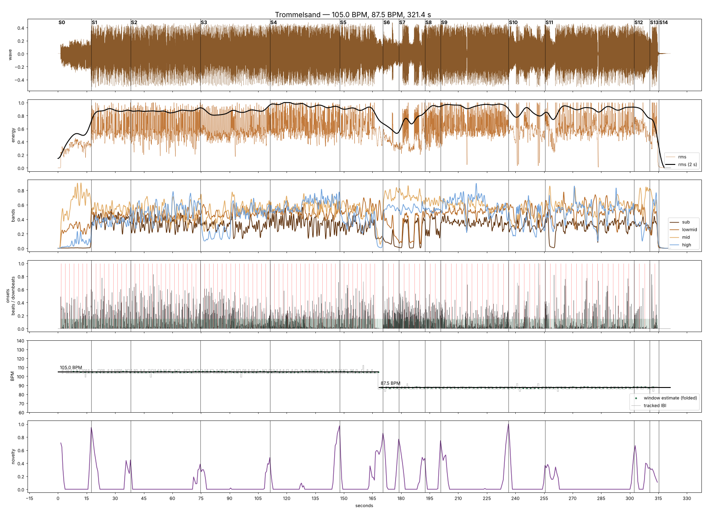
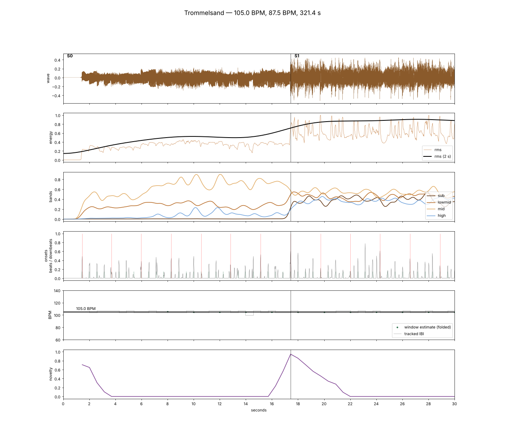
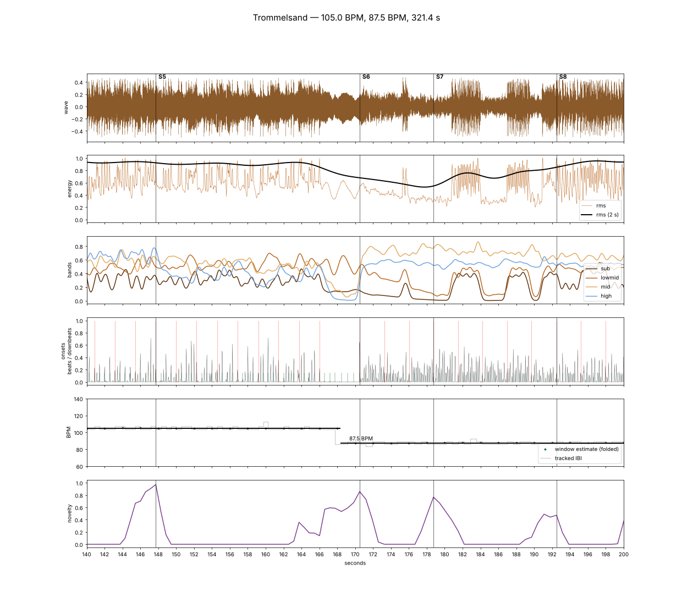
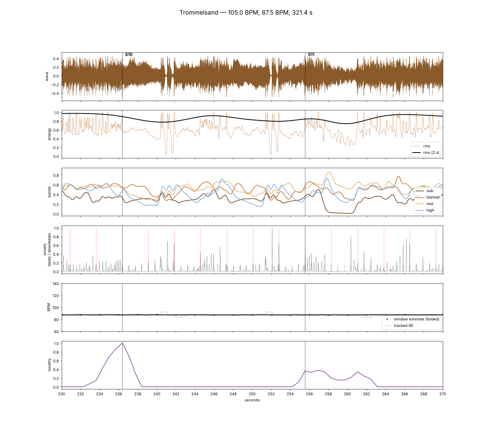
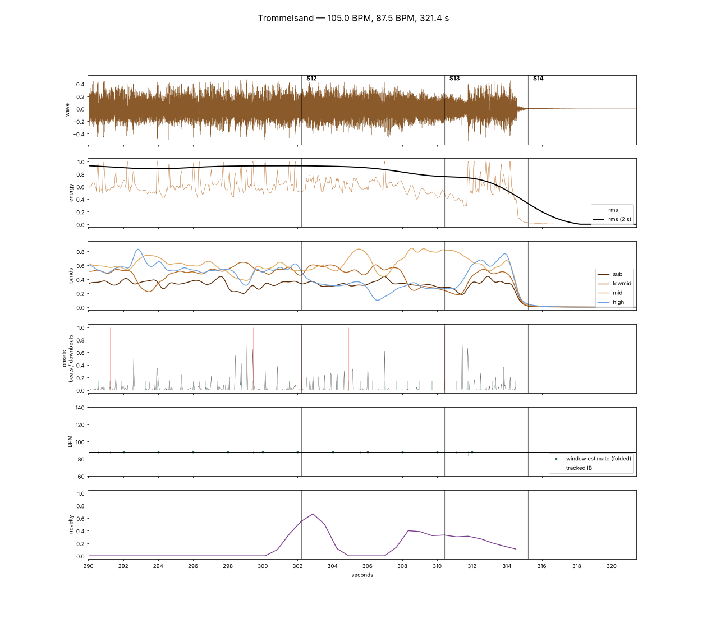
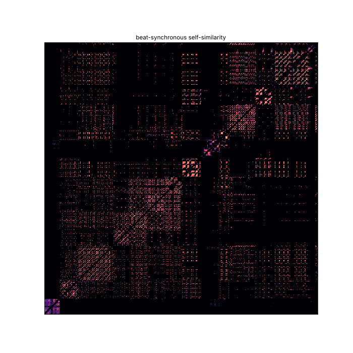

# 01 — Music analysis

Source: `audio/trommelsand.mp3` (320 kbps, 44.1 kHz, 5:21.4).
Reproduce with `python tools/analyze.py audio/trommelsand.mp3` → `analysis/`.

## Key findings

| | |
|---|---|
| Meter | 4/4 throughout (low-end accent on beat 1 is 25–30 % above the average beat) |
| Tempo, part A | **105.0 BPM** (0:00 – 2:50.5), bar = 2.286 s |
| Tempo, part B | **87.5 BPM** (2:50.5 – end), bar = 2.743 s, with a 175 BPM double-time hi-hat feel in places |
| Tempo ratio | 105 : 87.5 = **6 : 5** — a metric modulation, not a drift. The beat tracker holds ±15 ms around both values. |
| Riff length | part A: 16 beats (4 bars) · part B: 8 beats (2 bars) |
| Phrase length | part A: 16-bar blocks, almost exactly (bars 17, 33, 49, 65) |
| Bars | 127. Bar 74, the silent bar of the break, has no hit, so its downbeat is interpolated |
| Last hit | 5:14.6 — then 6.8 s of ring-out to 5:21.4 |

The tempo change is the dramatic hinge of the song: two bars of break
(bars 73–74, 2:46.0 – 2:50.5) where drums and bass drop out and the guitar rings,
then a new, slower and heavier riff starts at **2:50.5** (bar 75).

## Structure

Section boundaries come from novelty on the beat-synchronous self-similarity
matrix (chroma + MFCC + loudness), snapped to downbeats, then checked by eye
against the zoom plots below. Bars are counted from the first guitar note (bar 1 = 0:01.46).

| # | Time | Bars | BPM | What happens (from the curves) | Energy |
|---|---|---|---|---|---|
| Intro | 0:00.0 – 0:17.4 | 1–7 | 105 | Solo fuzz guitar from 0:01.5, no bass/kick; cymbal swell from ~0:07 | ▂▂ |
| A1 | 0:17.4 – 0:38.0 | 8–16 | 105 | **Full band slams in** on bar 8 | ▆▆ |
| A2 | 0:38.0 – 1:14.6 | 17–32 | 105 | Brightest part-A block, lots of cymbal | ▆▆ |
| A3 | 1:14.6 – 1:51.2 | 33–48 | 105 | Darker variation, cymbals pull back (≈1:30–1:40) | ▆▅ |
| A4 | 1:51.2 – 2:27.7 | 49–64 | 105 | Loudest block of part A | ▇▇ |
| A5 | 2:27.7 – 2:46.0 | 65–72 | 105 | Lower, darker riff (centroid drops to 1.7 kHz) — wind-down | ▆▅ |
| Break | 2:46.0 – 2:50.5 | 73–74 | → | Drums and bass stop at ~2:47.5, guitar rings / feeds back | ▃ |
| B1 | 2:50.5 – 2:58.7 | 75–77 | 87.5 | New riff, guitar + busy cymbals, **no bass** | ▄ |
| B2 | 2:58.7 – 3:12.5 | 78–82 | 87.5 | Stop-and-go: bass/kick stabs at 3:00.7, 3:06.8, 3:10.8 with gaps in between | ▅▃▅ |
| B3 | 3:12.5 – 3:20.7 | 83–85 | 87.5 | Full band rebuilds | ▆ |
| B4 | 3:20.7 – 3:56.4 | 86–98 | 87.5 | Main groove of part B, overall energy peak; micro-stop at 3:34.5 | ▇▇ |
| B5 | 3:56.4 – 4:15.6 | 99–105 | 87.5 | Heavy, dark, half-time riff; hard stabs/stops at 4:00.9, 4:01.6, 4:11.9 | ▆ |
| B6 | 4:15.6 – 5:02.2 | 106–122 | 87.5 | Bass out 4:17.6 – 4:20.9 (guitar + cymbal swell), then the long climax; stop at 4:43.2 | ▃▇▇ |
| B7 | 5:02.2 – 5:10.4 | 123–125 | 87.5 | Sustained heavy chords, low centroid | ▆ |
| End | 5:10.4 – 5:14.6 | 126–127 | 87.5 | Final hits | ▇ |
| Ring-out | 5:14.6 – 5:21.4 | — | — | Decay to silence | ▁ |

### Sync events (hard edges the picture must hit)

| Kind | Times |
|---|---|
| Hard stops | 3:34.5 · 4:00.9 · 4:01.6 · 4:11.9 · 4:43.2 · 5:14.6 |
| Bass/kick out | 0:00–0:17.4 · 2:51.3–2:55.2 · 2:56.1–3:00.7 · 3:04.0–3:06.8 · 3:09.6–3:10.8 · 4:17.6–4:20.9 · 4:43.0–4:43.5 · 5:14.6– |

## Close-ups

| Intro → band entry | Break + tempo change + stop-and-go |
|---|---|
|  |  |
| **Heavy riff with stabs, bass drop-out** | **Ending** |
|  |  |

Self-similarity (beat-synchronous) — the two big blocks are part A and part B:

## What the renderer gets (`analysis/analysis.json`)

- `tempo_regions`, `beats`, `downbeats`, `bars` (bar number → time, plus per bar: `energy`, `bright`,
  `kicks`, `snares`, `hats`, and `fill` = hits in the last beat, which leads into the next bar)
- `sections` (table above, plus per-section band energies)
- `events.stops`, `events.bass_out`
- `hits.kick`, `hits.snare`, `hits.hat`: `[time, weight 0..1]` from band-limited onsets of the
  percussive part. Bands: < 150 Hz, 150–2500 Hz and 6–11 kHz. Kicks only count when there is real
  sub-bass energy, because low guitar notes in the intro would otherwise trigger them. `snare` also picks up riff accents.
- `onsets` (time, strength)
- `curves.*` sampled at the video frame rate (25 fps), normalised 0..1:
  `rms`, `rms_slow`, `sub` (20–90 Hz, kick/bass), `lowmid` (90–400 Hz, fuzz body),
  `mid` (0.4–2.5 kHz, riff), `high` (2.5–11 kHz, cymbals), `onset`, `centroid`, `flatness`

## Bar-level structure (used for cutting)

- **Part A** (bars 8–72) is one long groove. The riff runs over 2 bars, and its first bar is the
  heavier one (more kicks). Drum fills sit in the last beat of 8-bar phrases: bars 24, 32, 48, 56, 64.
  Bar 52 has the biggest fill of part A (10 kicks).
- **Bars 34–39** drop the cymbals (`bright` ≈ 0.1–0.2), and **bar 40** (1:30.6) brings them back at once.
- **Part B:** the bass alternates per bar in 78–82, bar 84 is the loudest of the build, bar 98 is a
  fill into the storm, bars 99/100/103/104 are sparse (the half-time stabs), bar 107 has no bass, and bar 125 has no hits
  (a held chord).

## Method notes / pitfalls hit

- A single global beat tracker reported 107.7 BPM — a compromise between the two
  real tempi that drifts badly in part B. A tempogram per 15 s window showed
  105 vs. 86/172, so the tempo is now estimated per window with a comb filter
  over the onset autocorrelation (0.1 BPM resolution), octave-folded into
  70–140 BPM, merged into regions, and the beat tracker is driven by that map.
- The change point is refined to the beat where the inter-beat interval actually switches.
- Downbeat phase is chosen per tempo region by the strongest < 150 Hz accent.
- `librosa.util.sync` prepends a segment before the first beat — indices are shifted accordingly.
