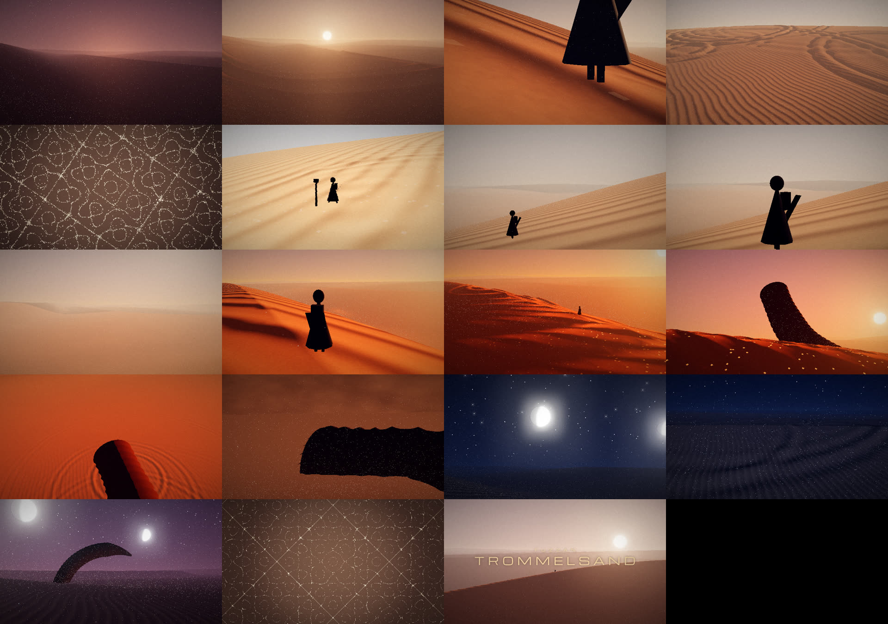
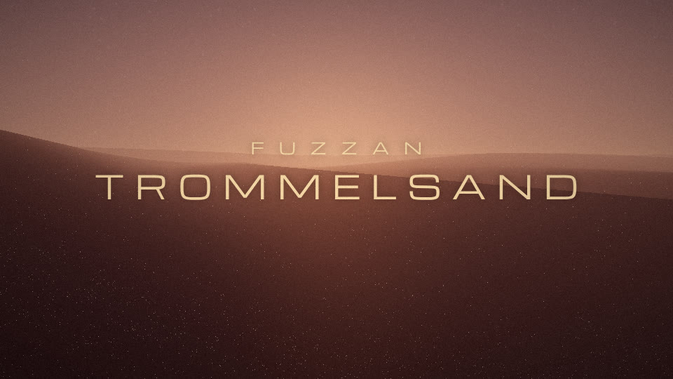

# 04 — Handoff: continue locally

State on 2026-10-12: analysis done, storyboard approved, and the three.js renderer is
**blocked in end to end**. Every one of the 20 shots exists, plays in sync with the song and renders
to mp4, but all of them are first passes. The next sessions are about making each shot good.



*First pass, middle of each shot, in order 02 → 20 (CPU render at 640×360).*



*Title card at 0:14.*

## 1. Set up on your PC

Needs: **git**, **Node 20+** (22 tested), **ffmpeg** on PATH (Windows: `winget install Gyan.FFmpeg`;
macOS: `brew install ffmpeg`). Python is only needed to re-run the analysis.

```bash
git clone https://github.com/erigrus/trommelsand.git
cd trommelsand
git checkout claude/stoner-rock-music-video-i69ecp   # or main once PR #1 is merged
cd video
npm install
npx playwright install chromium
npm run dev            # → http://localhost:5173
```

Preview controls: **space** play/pause · **←/→** one bar · **shift+←/→** previous/next shot ·
click or drag the timeline · **q** switch between full and half resolution · **h** hide the HUD.
`?t=200` starts at 200 s. `?quality=0.5` gives fewer vertices and particles for weak GPUs.
The HUD shows the shot, the section, live kick/snare/hat envelopes, fps, and the GPU in use.

Renders (all in `video/`):

```bash
npm run still -- --shots                         # one PNG per shot (out/stills/)
npm run render -- --from 17 --to 40 --w 960 --h 540   # draft clip with audio (out/)
npm run render                                   # final 1920x1080
```

Check the `renderer:` line printed by the scripts. It should name your GPU. If it says SwiftShader,
add `--headed`. Delete `out/chunks/` after any visual change, because finished chunks are reused.

## 2. Continue with Claude Code locally

Open the repo folder in Claude Code. It reads `CLAUDE.md` automatically. A good first prompt:

> Read docs/04-handoff.md. Start the dev server and render stills for shots 02–04, then work
> through the to-do list for those shots. Show me the stills before and after.

The agent can view PNG stills, so it can check its own visual work. You check motion and sync in the
browser preview.

## 3. Status per shot

| Shot | Time | State | To do (most important first) |
|---|---|---|---|
| 02 Intro | 0:00–0:17.4 | ◐ | Grain veils lifted by guitar notes are weak (global gust only). Make them visible plumes off the crest in front of the camera. Darker, bluer pre-dawn |
| 03 Band entry | 0:17.4–0:22 | ◐ | **The giant shockwave is too subtle.** Needs a visible wall of dust riding the wave front and a bright crest highlight. Sun should break the horizon exactly on the downbeat |
| 04 A1 walker | 0:22–0:38 | ◐ | Walker is a primitive cone figure, so model a proper cloaked silhouette. Footprints in the sand. Macro shot needs a real boot |
| 05 A2 flight | 0:38–1:14.6 | ◐ | Snare plumes off crests (spindrift) are missing. **Avalanche at bar 25 (0:56.3)** not built. Check the bank on turns |
| 06 A3 Chladni | 1:14.6–1:51.2 | ◑ | Works. Tune grain density and lighting, and pick nicer modes. Slip-face intercuts are basic |
| 07 A4 noon | 1:51.2–2:27.7 | ◐ | Walker is still on a ridge, but the storyboard wants a flat basin. Stake drive animation is crude. Cutting on every downbeat over bars 61–64 is in place |
| 08 A5 mound | 2:27.7–2:46 | ◐ | Mound reads only faintly at this distance. Add a dust trail |
| 09 Break | 2:46–2:50.5 | ◐ | Hanging grains work. Needs a hood close-up with better framing and bigger grains near the lens |
| 10 B1 drop | 2:50.5–2:58.7 | ◐ | Grains drop on the downbeat (hover → 0). The time-lapse sun move is from look.js. Make the 175 BPM ripple skitter visible |
| 11 B2 approach | 2:58.7–3:12.5 | ◐ | Mound moves only while the bass plays ✓. **The walker should move in the gaps ("walking without rhythm")**, but is static now |
| 12 B3 build | 3:12.5–3:20.7 | ◐ | Dunes buckling ahead of the mound is missing |
| 13 Breach | 3:20.7 | ◐ | Worm is a tube. Needs a proper ring mouth facing the camera, a sand fountain and falling sand |
| 14 B4 ride | 3:20.7–3:56.4 | ◐ | Walker on the worm's back isn't readable. Worm surface needs segments, a wake and spray. Freeze frame at 3:34.5 works (global stop) |
| 15 B5 storm | 3:56.4–4:15.6 | ◐ | Storm is fog plus streaks. Needs a storm wall and volumetric layers. Lightning only flashes on the detected stops (4:00.9, 4:01.6, 4:11.9) |
| 16 Eye | 4:15.6–4:20.9 | ◑ | Moons and stars work. The storm-to-night transition is a 2.5 s blend in look.js; it may want a visible storm wall opening up |
| 17 B6 night drum | 4:20.9–5:02.2 | ◐ | Spice motes and rings work. Rings at night need a light-emitting wave front. Blackout at 4:43.2 plus a giant ring after it is in place |
| 18 B7 dive | 5:02.2–5:10.4 | ◐ | Worm arc geometry is placeholder |
| 19 Final hits | 5:10.4–5:14.6 | ◑ | Pattern snaps on each kick and morphs into a drumhead ✓. Tune |
| 20 Ring-out | 5:14.6–5:21.4 | ◑ | Title and fade work. Walker is very small. Last grains settling is missing |

◐ blocked in · ◑ close · ● done

## 4. Cross-cutting to-do

- **Walker model:** cloak with cloth sway, hood, pack, proper walk cycle (step on kick, as now).
- **Worm model:** segmented plates, mouth petals/teeth, sand pouring off the body.
- **Crest plumes:** per-snare plumes from the dune crests in view (spawn at the crest nearest a
  hashed point, stateless).
- **Ring wave front:** add a dust burst on the front (particles already jump; make it read at a distance).
- **Look pass:** the fog and haze balance per shot, the noon white-out, and a stronger contrast curve.
- **Performance check on your GPU:** `npm run dev` should be near real time at 1080p. If not,
  lower the shadow-march steps (terrain.js) and `MAX_RINGS` first.
- **Cut timing:** cuts happen `CUT_LEAD = 0.06 s` before the downbeat (timeline.js). Judge it in the preview.

## 5. Definition of done

Every shot is ● in the table above. A full 1080p render plays in sync start to finish. The process log
in `docs/00-process.md` covers each session. PR merged.
