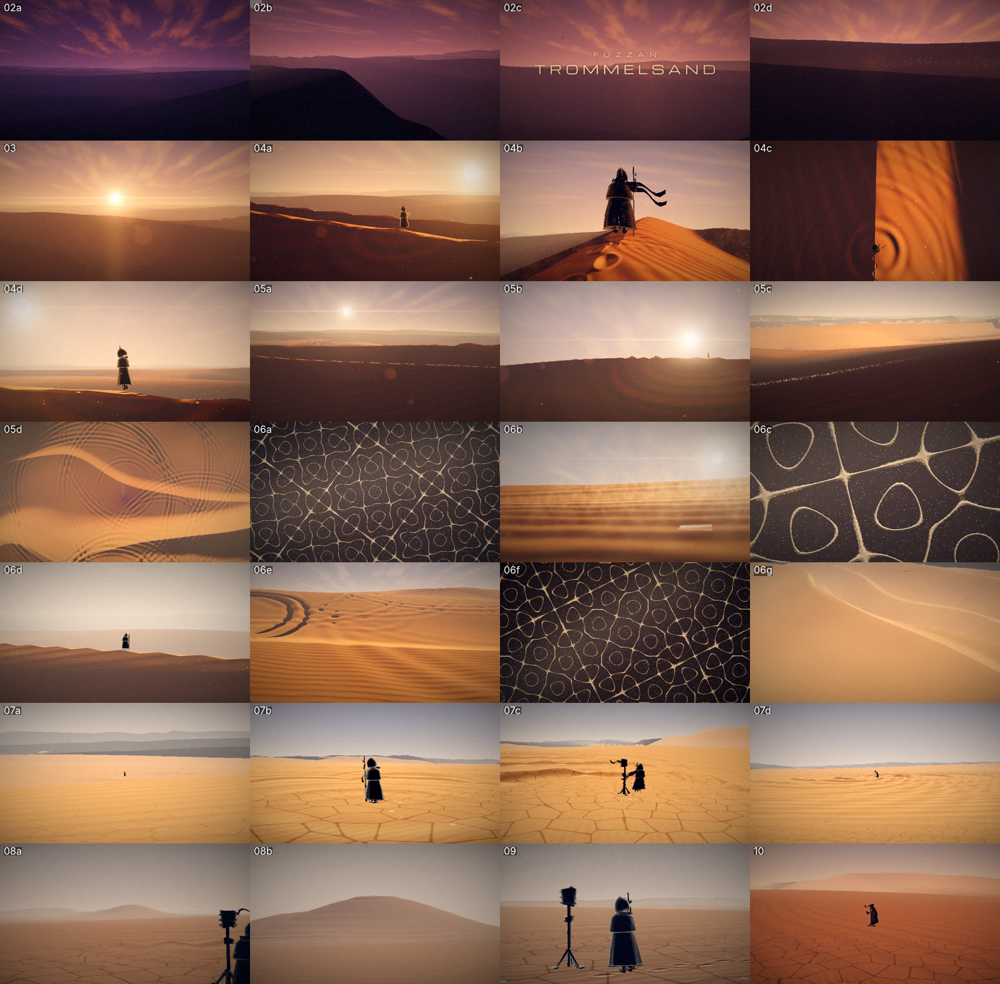
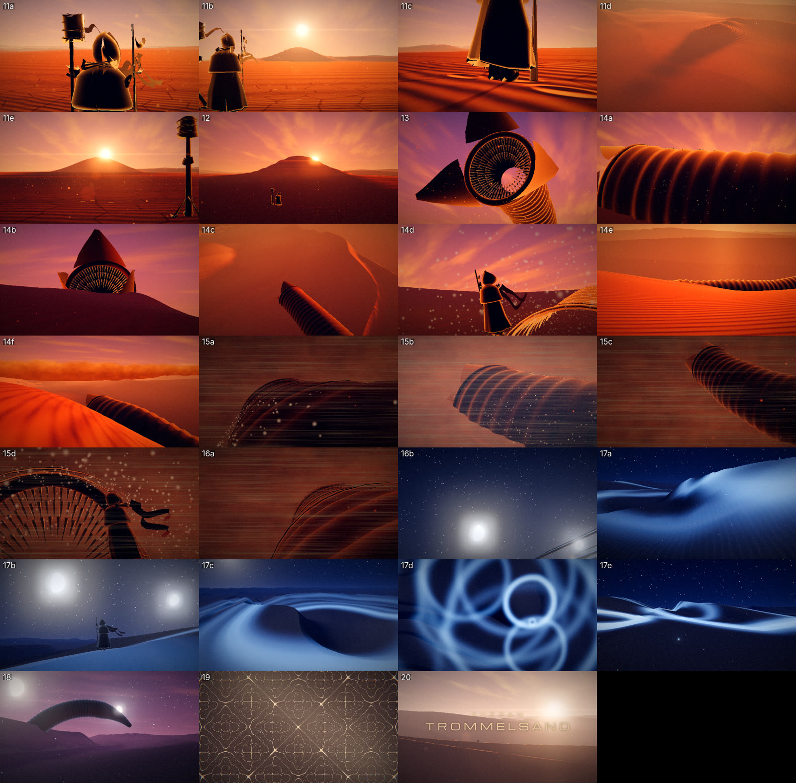

# 04 — Handoff: continue locally

State on 2026-10-12, **v2 ("beautify" pass)**: all 55 cuts are built, locked to the music's bars,
hits and section edges, and rendered with the new look. The terrain, lighting, sky, light rays,
particles, figures and grade were all rebuilt. The final render has motion blur. Everything was checked on stills
and frame strips in the cloud container (CPU only). **Nobody has watched it in real time with the song yet:**
that is the first job at home.




*v2, middle of every cut (CPU render at 640×360). For comparison, the first pass is
[img/first-pass-contact.jpg](img/first-pass-contact.jpg).*

## 1. Set up on your PC

Needs: **git**, **Node 20+** (22 tested), **ffmpeg** on PATH (Windows: `winget install Gyan.FFmpeg`;
macOS: `brew install ffmpeg`). Python is only needed to re-run the analysis.

```bash
git clone https://github.com/erigrus/trommelsand.git
cd trommelsand
git checkout claude/stoner-rock-music-video-i69ecp   # or main once PR #1 is merged
cd video
npm install
npx playwright install chromium
npm run dev            # → http://localhost:5173
```

Preview controls: **space** play/pause · **←/→** one bar · **shift+←/→** previous/next shot ·
click or drag the timeline · resolution menu (270p–1080p) · **h** or the Info button toggle the HUD.
There are touch buttons for all of these.
`?t=200` starts at 200 s. `?quality=0.5` gives fewer vertices and particles for weak GPUs.
The HUD shows the shot, the section, live kick/snare/hat envelopes, fps, and the GPU in use.

Renders (all in `video/`):

```bash
npm run still -- --shots                         # one PNG per cut (out/stills/)
npm run cuts                                     # print the cut list (bars, times, names)
npm run render -- --from 17 --to 40 --w 960 --h 540 --mb 1   # quick draft clip with audio (out/)
npm run render                                   # final 1920x1080 with motion blur (--mb 6)
```

Check the `renderer:` line printed by the scripts. It should name your GPU. If it says SwiftShader,
add `--headed`. Delete `out/chunks/` after any visual change, because finished chunks are reused.

### Web preview (phone)

A private web build of the preview player is published at
https://claude.ai/artifact/ASeqDKiXovyyoWkscGa99o and renders live on the device; phones default to 360p.
To update it, run `npm run build:web` in `video/`, then republish `dist/` (page = `dist/page.html`,
plus `dist/assets/*`). In Claude Code, ask Claude to republish the artifact at that URL.
Other static hosts can serve `dist/index.html` as-is.

## 2. Continue with Claude Code locally

Open the repo folder in Claude Code. It reads `CLAUDE.md` automatically. A good first prompt:

> Read docs/04-handoff.md. Start the dev server and render stills for shots 02–04, then work
> through the to-do list for those shots. Show me the stills before and after.

The agent can view PNG stills, so it can check its own visual work. You check motion and sync in the
browser preview.

## 3. Status per shot

| Shot | Cuts | Time | State | What's left |
|---|---|---|---|---|
| 02 Intro | 02a–d | 0:00–0:17.4 | ◑ | Blue hour and dawn clouds look right. The dissolving title grains read as specks in 02d; maybe make them warmer or larger |
| 03 Band entry | 03 | 0:17.4–0:22 | ◑ | Sunrise and flash land on the downbeat. Judge in motion whether the giant ring reads as it rolls in |
| 04 A1 walker | 04a–d | 0:22–0:38 | ◑ | Silhouette, footprints and step rings work. The walker model is fine from mid distance but not for macros |
| 05 A2 flight | 05a–d | 0:38–1:14.6 | ◑ | 05d (rings like rain) is strong. The 05c sand pour over the crest is subtle; add more particles or move the camera closer |
| 06 A3 plate | 06a–g | 1:14.6–1:51.2 | ◑ | The plate looks good. 06b (ripple macro) and 06g (dive) are plain |
| 07 A4 noon | 07a–d | 1:51.2–2:27.7 | ● | Cracked basin, rings on the hardpan, thumper slam on bar 57 |
| 08 A5 mound | 08a–b | 2:27.7–2:46 | ◑ | The mound reads now. The dust plume is faint |
| 09 Break | 09 | 2:46–2:50.5 | ◑ | Hanging grains plus the push-in. Check in motion |
| 10 B1 drop | 10 | 2:50.5–2:58.7 | ◑ | Time-lapse orbit. Check the ripple skitter on hats in motion |
| 11 B2 approach | 11a–e | 2:58.7–3:12.5 | ◑ | Cuts follow the bass on/off. In 11c the walker only animates the legs in place; let him actually move |
| 12 B3 build | 12 | 3:12.5–3:20.7 | ● | The mound grows against the sun |
| 13 Breach | 13 | 3:20.7 | ● | Mouth toward the camera, petals open, teeth, sand pouring |
| 14 B4 ride | 14a–f | 3:20.7–3:56.4 | ◑ | 14a, 14b and 14d are strong. 14c (aerial) is plain |
| 15 B5 storm | 15a–d | 3:56.4–4:15.6 | ● | Wall hits on bar 99; streaks; lightning on the stabs |
| 16 Eye | 16a–b | 4:15.6–4:21 | ● | The calm cuts in on the bass drop-out and the moons appear |
| 17 B6 night drum | 17a–e | 4:21–5:02.2 | ◑ | Glowing rings are great (17d). In 17b the circling worm doesn't read at night |
| 18 B7 dive | 18 | 5:02.2–5:10.4 | ◑ | Silhouette at dawn. Could use a closer second angle |
| 19 Final hits | 19 | 5:10.4–5:14.6 | ◑ | The drumhead morph works, but the image could hit harder |
| 20 Ring-out | 20 | 5:14.6–5:21.4 | ◑ | Title and fade work. The figure is very small |

◐ blocked in · ◑ close · ● done

## 4. Cross-cutting to-do

- **Watch it with the song** (`npm run dev`) and note the cuts that feel late or early. Adjust with
  `CUT_LEAD` or per cut in `timeline.js`.
- **GPU performance:** the shaders are much heavier now (shadow march, 60k spindrift particles that each
  evaluate the dunes 5×). If the preview is slow at 1080p, use 540p for previewing. For speed, lower the
  `drift` count in `director.js` and the shadow steps in `terrain.js` first.
- **Render time:** `--mb 6` renders every frame six times. Do a `--mb 1` draft of the whole video first.
- **Phone preview** gets heavy with these shaders. It defaults to 360p with half geometry; 270p is the fallback.
- **Walker close-ups:** a proper cloth/figure model would allow macros again (04b was replaced for this reason).

## 5. Definition of done

Every shot is ● in the table above. A full 1080p render plays in sync start to finish. The process log
in `docs/00-process.md` covers each session. PR merged.
