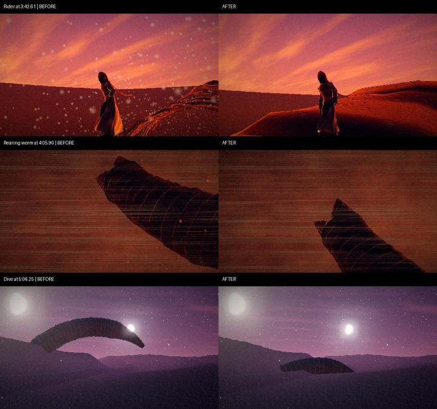
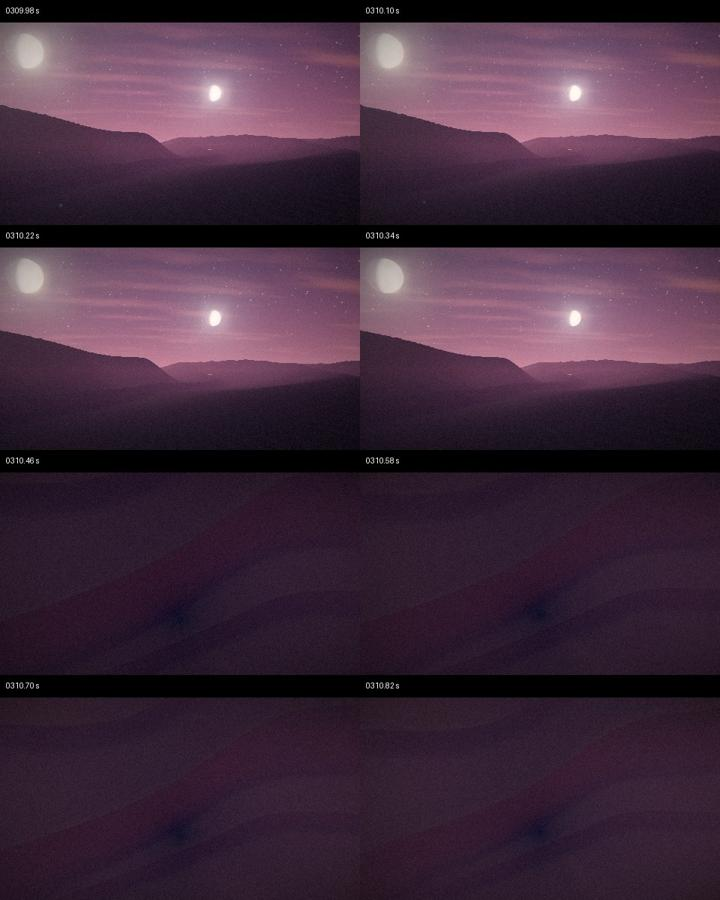

# Video review — 2026-11-16

Reviewed v3 on `claude/stoner-rock-music-video-i69ecp`, the source branch of draft PR #1.
The default branch has no video implementation.

| Defect | Correction |
|---|---|
| Waves slide with the camera, mound or worm after impact | Each centre is evaluated at the hit time. A baseline flight wave moved 8.64 m in 0.12 s; all 44 tested emitters now stay fixed. |
| Rider intersects the raised back, particularly when the worm rears | Place the rider on the body curve plus its upward radial direction, and follow its heading. |
| Braced figures lean farther each time the same frame is rendered | Restore the unbraced hips before animation sampling; the mixer's unchanged-sample cache no longer accumulates the manual lean. |
| Frozen frames still animate grain and storm streaks | Use the held time for post effects as well as the world. All five hard stops now hold identical pixels. |
| Blackouts and final fade contain visible grain | Apply fade after grain and the rest of the grade. Tested blackout/fade frames are exactly black. |
| Close walking cameras inherit step motion through their aim | Aim at the same smoothed anchor used for camera placement. |
| Walker retreats in 11c and teleports back in 11d | Carry the hat-driven displacement and facing into the following shots and breach. |
| Worm disappears at the final-hit cut with body still exposed | Lower the entire diving body beneath the terrain before the cut. Final-hit rings use the head end, rather than the tail end. |
| Fog/particle camera origin differs from a camera lifted by the ground guard | Refresh the shared origin after the guard. |
| First analysis-curve interval holds instead of interpolating | Interpolate frame zero to frame one like the other intervals. |

## Visual evidence

Before/after samples at matching music times (480×270, CPU renderer):



Eight frames at 0.12 s intervals across the dive/final-hit transition, starting at 309.98 s.
The body has already submerged before the overhead cut; frame times are rounded to 25 fps by the still script.



## Validation

From `video/`:

```bash
CHROME_PATH=/usr/bin/chromium npm test -- --swiftshader
npm run build:web
```

The browser suite checks finite transforms across all 55 cuts, fixed origins for 44 wave emitters,
all five pixel-identical hard stops, exact black at intro/blackout/outro, seek-away/seek-back pixel equality,
full submersion at the last dive frame, camera-uniform agreement, first-interval curve interpolation,
and the procedural fallback when both model formats are unavailable.

Rendered and inspected every original cut midpoint at 480×270, then rerendered affected walking,
retreat, breach, riding, storm, dive and fade samples, including the eight-frame transition strip.
Stills and build output are under git-ignored `video/out/` and `video/dist/`; representative evidence is above.

This was a sampled visual and runtime review on SwiftShader. A complete real-time viewing with the song,
a full 1080p master, and GPU/phone performance checks remain to be done. The skeleton's repetitive silhouette,
some distant figures and the sparse aerial compositions remain aesthetic limitations. Cut timing was preserved.
Delete existing `out/chunks/` before rendering the corrected version.
